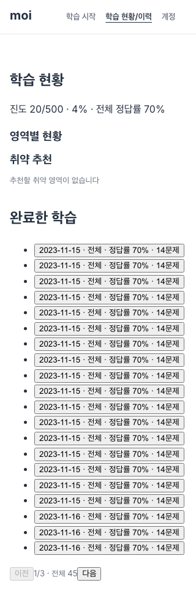
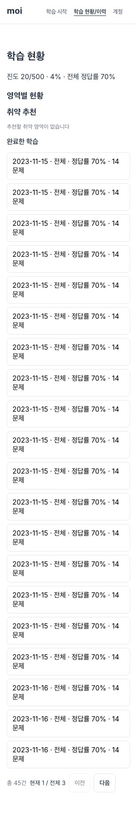
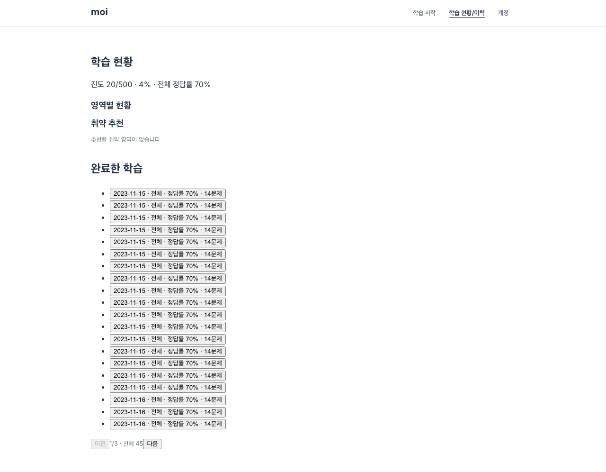
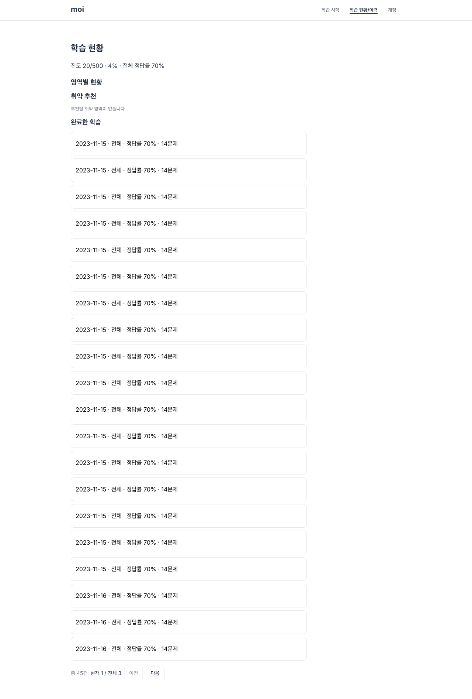

# #148 이력 화면 전후 검증

- 로컬 Chromium에서 가짜 인증·통계·45건 이력 API 응답으로 검증했다. 실계정·배포 검증이 아니다.
- 이전 코드: `62c5176`, 이후 코드: `175e32e`. 320/375/768/1024/1280px 전체 가로 넘침 없음, 실제 2페이지 응답 확인.
- 수정 전에도 기본 2페이지 서버 요청은 동작했다. 수정 후 URL `?page=2` 보존, 페이지 버튼 높이 44px을 확인했다.
- 독립 이력 화면의 CSS 누락을 고친 뒤 이력 행은 16px Inter·높이 64px으로 실측했다.
- 첨부: 모바일 320px·데스크톱 1280px의 이전/이후 캡처, 5개 폭의 `results.json`.
- 모든 핵심 화면·내부 학습 UUID 주소·인증 복귀·복습 UI·Lighthouse·실사용 승인을 이 증거로 대체하지 않는다.

| 폭 | 이전 | 이후 |
| --- | --- | --- |
| 320px |  |  |
| 1280px |  |  |
